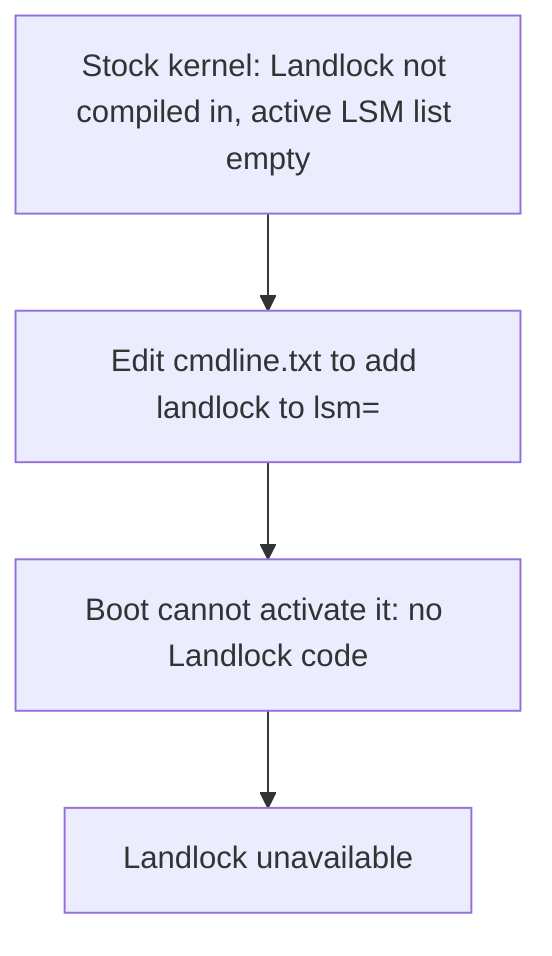
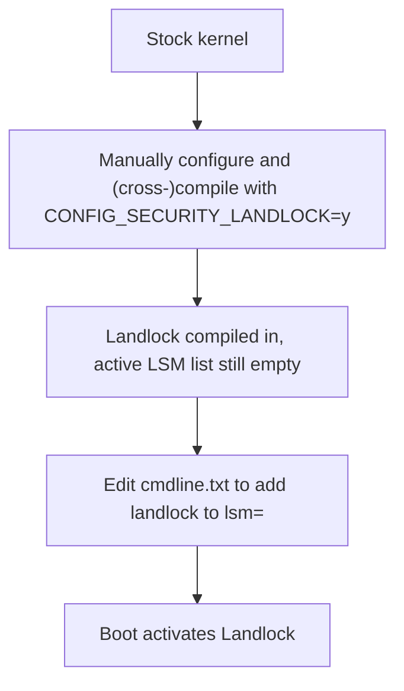
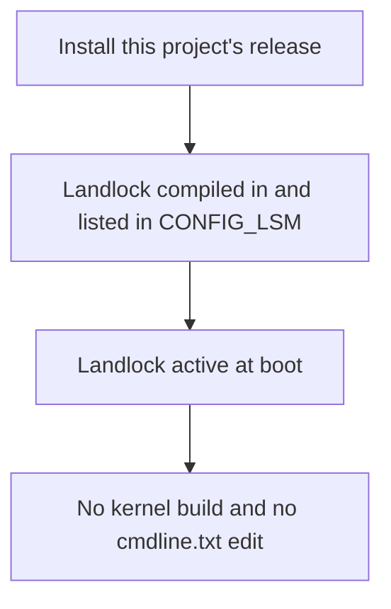

# raspberrypi-kernel-with-landlock

This project builds and releases the latest stable Raspberry Pi Linux kernel and modules, based on the [`raspberrypi/linux`](https://github.com/raspberrypi/linux) repository's [tags page](https://github.com/raspberrypi/linux/tags), with one configuration change: [Landlock](https://landlock.io/) is enabled and added to the active Linux Security Modules (LSM) list.

> [!IMPORTANT]
> **This is an independent project.** It is not made, endorsed, or supported by [Raspberry Pi Holdings plc](https://en.wikipedia.org/wiki/Raspberry_Pi_Holdings), the [Linux Foundation](https://en.wikipedia.org/wiki/Linux_Foundation), the [Linux Kernel Organization](https://www.kernel.org/category/about.html), or [Linus Torvalds](https://en.wikipedia.org/wiki/Linus_Torvalds).

## Why this exists

Raspberry Pi's official 64-bit kernels ship without [Landlock](https://landlock.io/), a Linux security feature that lets an unprivileged process restrict its own filesystem and network access. This project enables Landlock and adds it alongside AppArmor to the default list of active security modules.

> [!NOTE]
> A **defconfig** is a file that sets the default build options for a kernel. Raspberry Pi publishes one for each 64-bit chip family: `bcm2711` (Raspberry Pi 4) and `bcm2712` (Raspberry Pi 5). Building a kernel starts from its defconfig, so the defconfig decides what is compiled in and what is active at boot. The defconfigs can be found in the [`raspberrypi/linux`](https://github.com/raspberrypi/linux/) repository for the [64-bit Raspberry Pi kernels](https://github.com/raspberrypi/linux/tree/rpi-6.18.y/arch/arm64/configs) ([bcm2711_defconfig](https://github.com/raspberrypi/linux/blob/rpi-6.18.y/arch/arm64/configs/bcm2711_defconfig) and [bcm2712_defconfig](https://github.com/raspberrypi/linux/blob/rpi-6.18.y/arch/arm64/configs/bcm2712_defconfig)). Neither of the `bcm2711` and `bcm2712` defconfigs enable Landlock, and both set `CONFIG_LSM=""`, which leaves the default list of active security modules empty. Raspberry Pi devices can therefore support Landlock but do not use it by default.

### An analogy to help understand this project

Enabling Landlock on Raspberry Pi devices is possible, but it requires "wiring" and "switching on", similar to installing a new light fixture in a physical space (e.g., an overhead light in a kitchen).

- **The power grid** is what provides the electricity necessary for the light switch to function. Here, the "power grid" is the set of features which the Linux kernel supports.
- **The wiring** is the connection between the light switch and the power grid. Here, the wiring is the capability built in before compilation which is *selected* via [configuration](https://www.raspberrypi.com/documentation/computers/linux_kernel.html#configure-the-kernel) (i.e., `CONFIG_SECURITY_LANDLOCK=y`).
- **The light switch** is the mechanism by which the light is activated and deactivated. Here, the light switch is the user's control over which LSMs are active. The build sets the default with `CONFIG_LSM`, and [users can change it](https://www.raspberrypi.com/documentation/computers/configuration.html#cli-splash) with `cmdline.txt`.
- **The light** is the lightbulb, or other fixture, which is powered by electricity and connected to a switch of some kind. Here, the "light" is an LSM, namely Landlock.

In terms of this analogy, this project adds new wiring to support Landlock and flips the switch on by default. It also flips the existing (i.e, already-wired) switch for "AppArmor". The diagrams below

#### Consequences of editing `cmdline.txt` only

On the stock build, the grid supports Landlock, but the wiring is missing, so flipping the switch in `cmdline.txt` does nothing. AppArmor, in contrast, is already wired to the grid, so the same kind of switch works for it.



#### Adding LandLock manually: configure, compile, then edit `cmdline.txt`

Building the same kernel by hand can be slow, taking anywhere between ten minutes and an hour, or more, depending on the device. It has to be repeated for each kernel update with modules that match the new kernel. Plus, rebuilding with the wiring alone leaves the default list empty, so Landlock stays inactive until `cmdline.txt` also names it.



#### This project: configuration, compilation, and enabling built-in

This project does the work of configuring, cross-compiling, and enabling Landlock for each release, and the [install steps](#download-and-install) use the result.



## Why you would use it

Landlock lets you limit what processes, such as AI coding agents, can access on your Raspberry Pi. You might want this when various processes run on the device, especially agentic harnesses.

Various solutions for sandboxing AI agents, like [nono](https://nono.sh/docs/cli/internals/landlock#what-is-landlock), [fencesandbox](https://fencesandbox.com/docs/reference/linux-security-features#security-layers), and [NVIDIA OpenShell](https://docs.nvidia.com/openshell/latest/how-it-works/policies/schema#landlock) require Landlock to be installed for their functionality to be fully operational.

If you're running an AI agent on your Raspberry Pi device and you want to secure it using a sandboxing solution like those listed, then you would want to have a kernel with Landlock enabled.

> [!NOTE]
> There is one solution to AI agent sandboxing which does not require Landlock: [docker sandboxes](https://docs.docker.com/ai/sandboxes/). However, these may be computationally more expensive, especially at scale, since they spin up microVMs. In contrast, a solution like [nono](https://nono.sh/) is more computationally efficient and provides similar sandboxing security, though not to the extent of a microVM solution.

## Targets

Only 64-bit (arm64) kernels are built.

| Target folder | Kernel image | Defconfig | Release suffix | Devices |
|---|---|---|---|---|
| `bcm2711` | `kernel8.img` | `bcm2711_defconfig` | `-v8-landlock` | Raspberry Pi 3, 3+, CM3, CM3+, Zero 2 W, 4, 400, CM4, CM4S, 5, 500, 500+, CM5 *(4K pages)* |
| `bcm2712` | `kernel_2712.img` | `bcm2712_defconfig` | `-v8-16k-landlock` | Raspberry Pi 5, 500, 500+, Compute Module 5 *(optimized build, 16K pages)* |

## Releases

Releases are tagged `v<kernel-version>-landlock-<revision>`, for example `v6.18.50-landlock-3`. One tag covers all targets. The revision increases for each rebuild because tags are never moved.

The kernel source is pinned to a commit in `kernel/pins.env`. Each release states the pinned tag and commit in its `manifest.json`.

### Release process

1. Every Monday at 06:00 UTC, the `upstream-sync` workflow checks `raspberrypi/linux` for the newest `stable_YYYYMMDD` tag. If that tag is newer than the pin in `kernel/pins.env`, the workflow opens a pull request that moves the pin to the new tag and commit, or updates the pull request if one is already open. The workflow can also be started by hand from the **Actions** tab.
2. The pull request states the new kernel version and whether the baseline config packages exist for each target. The maintainer reviews it and merges it. Merging does not start a build.

> [!NOTE]
> The pull request is opened with the default `GITHUB_TOKEN`, which does not trigger other workflows. No CI checks run on it, so the review is the only check before the tag.

3. The maintainer pushes a tag matching `v<kernel-version>-landlock-<revision>`. The tag must match the kernel version of the pinned commit.
4. GitHub Actions builds every target. The release job waits for approval from a reviewer of the `release` environment.
5. The release job attests the files and creates a **draft** release. The draft is not public.
6. The maintainer checks the draft, signs each `manifest.json` with the release key, uploads the `.asc` files, and publishes.

### Verify a release

Each release has these files:

- `<target>-<tag>.tar.gz`, one archive per target. It unpacks to a `<target>/` folder containing `kernel_2712.img` (or `kernel8.img`), `modules.tar.gz`, `.config`, `landlock.config`, `pins.env`, `config-<target>.diff` and `manifest.json`.
- `raspberrypi-linux-<pinned tag>.tar.gz`, the source tarball of the pinned commit. This is the source offer for the binaries.
- `<target>-manifest.json.asc`, the release-key signature of that target's `manifest.json`. The release owner uploads it after review.

Check a release with these three independent checks.

#### 1. Provenance (GitHub attestations)

Every file is attested by the release workflow. Verify the archives after downloading them:

```bash
gh release download <tag> --repo uncommonraven/raspberrypi-kernel-with-landlock

gh attestation verify <target>-<tag>.tar.gz \
  --repo uncommonraven/raspberrypi-kernel-with-landlock \
  --signer-workflow uncommonraven/raspberrypi-kernel-with-landlock/.github/workflows/release.yml
```

Unpack the archive, then verify each file inside it with the same flags:

```bash
tar -xzf <target>-<tag>.tar.gz
for f in <target>/* <target>/.config; do
  gh attestation verify "$f" \
    --repo uncommonraven/raspberrypi-kernel-with-landlock \
    --signer-workflow uncommonraven/raspberrypi-kernel-with-landlock/.github/workflows/release.yml
done
```

For offline use, run `gh attestation download <file> --repo uncommonraven/raspberrypi-kernel-with-landlock`. This saves a bundle file, which you can then check with `gh attestation verify <file> --bundle <bundle>` and the same flags.

#### 2. Release key (GPG)

The manifest is signed with a dedicated GPG release key. The key is served from GitHub, and you must compare its fingerprint with the one below. A key downloaded from a website is only trustworthy if its fingerprint matches.

```bash
curl -fsSL https://github.com/uncommonraven.gpg | gpg --import
gpg --fingerprint
```

The fingerprint must be:

```bash
DFEC9DA3231902E9BB40303EAD0178802DBDE18F
```

Once the fingerprints match, check the signature:

```bash
gpg --verify <target>-manifest.json.asc <target>/manifest.json
```

#### 3. Hashes

Each file's SHA-256 is listed in `manifest.json`. Check them with the script from the tagged commit. Run these commands in the directory where you unpacked the archive, so that `<target>/` is visible:

```bash
git clone --depth 1 --branch <tag> https://github.com/uncommonraven/raspberrypi-kernel-with-landlock
raspberrypi-kernel-with-landlock/scripts/collect-release.sh /tmp/verified <target>=<target>
```

This detects corrupted or swapped files. It does not prove who made them, which is what the first two checks are for.

#### Other files

- The `config-<target>.diff` file shows its differences from Raspberry Pi's configuration for the same release. Read it to confirm that only Landlock options and toolchain-driven differences changed.

- `manifest.json` also records the kernel's `vermagic` string and the Raspberry Pi package used as the config baseline.

## Download and install

Verify the release first. Then find your device in this table, and use its target and image name wherever the steps show `<target>` and `<image>`.

| Device | Target (`<target>`) | Image (`<image>`) |
|---|---|---|
| Raspberry Pi 5, 500, 500+, Compute Module 5 | `bcm2712` (recommended) | `kernel_2712.img` |
| Raspberry Pi 3, 3+, Compute Module 3, 3+, Zero 2 W, 4, 400, Compute Module 4, 4S, 5, 500, 500+, Compute Module 5| `bcm2711` | `kernel8.img` |

> [!IMPORTANT]
> Pi 5, 500, 500+ and CM5 can technically use either image, but all other devices should use `bcm2711`. This project recommends `bcm2712` for Pi 5 devices because Raspberry Pi states that version is optimized for them in their documentation [here](https://www.raspberrypi.com/documentation/computers/linux_kernel.html#64-bit-architecture).

1. Download the archive for your target from the [GitHub Releases](https://github.com/uncommonraven/raspberrypi-kernel-with-landlock/releases) page, onto your Raspberry Pi device, and unpack it. Use the release tag, for example `v6.18.50-landlock-3`:

   ```bash
   curl -fLO https://github.com/uncommonraven/raspberrypi-kernel-with-landlock/releases/download/<tag>/<target>-<tag>.tar.gz
   tar -xzf <target>-<tag>.tar.gz
   ```

   The archive unpacks to a `<target>/` folder containing the image, `modules.tar.gz` and `manifest.json`.

2. Find where the boot partition is mounted. It should be at `/boot/firmware` (`findmnt /boot/firmware` shows it).

3. Record the current state. If a custom kernel is already installed, its image is not the stock one, so do not assume otherwise:

   ```bash
   uname -r
   ls -l /boot/firmware/*.img
   grep -n '^kernel=' /boot/firmware/config.txt   # no output means the firmware uses its default image
   ls /lib/modules
   ```

4. Keep the current image so you can roll back. `cp -n` refuses to overwrite an existing backup:

   ```bash
   sudo cp -n /boot/firmware/<image> /boot/firmware/<image>.previous
   ```

   Skip this step if `<image>` does not exist yet.

5. Copy the new image to the boot partition:

   ```bash
   sudo cp <target>/<image> /boot/firmware/
   ```

   Make sure `config.txt` loads it. If there is a `kernel=` line, it must name `<image>`, or the line must be removed. If the old `kernel=` line names a different custom image, change it to `kernel=<image>`. The Pi 3 and Pi 4 families must also boot the 64-bit kernel, which needs `arm_64bit=1` in `config.txt` unless a `kernel=` line names `kernel8.img`.

6. Install the modules. Do not use the stock modules, because they are built for a different kernel release. The release name is the first word of `vermagic` in `<target>/manifest.json`. Run this in the same command as the following two lines, or write the name down, because a shell variable does not survive a new SSH session:

   ```bash
   release=$(sed -n 's/^  "vermagic": "\([^" ]*\).*/\1/p' <target>/manifest.json)
   echo "$release"
   sudo mkdir -p "/lib/modules/$release"
   sudo tar -xzf <target>/modules.tar.gz -C "/lib/modules/$release"
   ```

   Modules from an earlier custom kernel stay in their own `/lib/modules/<release>` directory. Remove them only after the new kernel boots.

   The modules include Wi-Fi (`brcmfmac`) and TUN, which are built as modules.

7. Reboot with `sudo reboot`.

8. Check the result after the Pi comes back online. Use the release name from step 6 (it is `6.18.50-v8-16k-landlock` for `bcm2712` and `6.18.50-v8-landlock` for `bcm2711`, but compare it with the echoed value):

   ```bash
   uname -r                       # should print the release name from step 6
   cat /sys/kernel/security/lsm   # should include "landlock"
   ```

   To read the full config, load the `configs` module first, then check the file:

   ```bash
   sudo modprobe configs
   zcat /proc/config.gz | grep CONFIG_SECURITY_LANDLOCK
   ```

   The line should read `CONFIG_SECURITY_LANDLOCK=y`.

No `cmdline.txt` change is needed. Device tree blobs and overlays are not part of the release, so the ones already in `/boot/firmware` are used.

To roll back, restore the previous image, remove the `kernel=` line if you added one, and reboot:

```bash
sudo cp /boot/firmware/<image>.previous /boot/firmware/<image>
```

The old modules stay in their own `/lib/modules/<release>` directory, so the previous kernel can boot with them.

## FAQ

### How frequently is the released kernel updated?
It's updated whenever the latest stable version in `raspberrypi/linux` is updated. A weekly cron job checks if that latest stable version has changed from the one which is pinned.

### Could there ever be a point when this project becomes irrelevant?
Yes. If the Raspberry Pi team decides to include Landlock within their defconfigs by default, then this project can lose its entire purpose.

### Can I build this configured kernel locally, on my machine?

The release build runs in a `debian:trixie` container, which provides GCC 14.2 to match Raspberry Pi's baseline for the sake of consistency and reproducibility. However, this is not strictly necessary; as long as your machine is capable of cross-compiling the Linux kernel, you can build this locally.

To build the same way, use Debian trixie (or that container) and install:

```bash
sudo apt-get install -y --no-install-recommends \
  build-essential crossbuild-essential-arm64 ccache bc bison flex \
  libssl-dev libelf-dev dwarves binutils kmod curl ca-certificates git
```

Then, from the repository root:

```bash
scripts/build.sh bcm2712_defconfig kernel_2712.img build/bcm2712 -v8-16k-landlock
```

The arguments are the defconfig, the image name, the output directory (relative to the repository root), and the `CONFIG_LOCALVERSION` suffix, which must end in `-landlock`. For `kernel8`, use `bcm2711_defconfig kernel8.img build/bcm2711 -v8-landlock`.

The script:

1. Fetches the pinned commit into `build/src` (needs access to `github.com`).
2. Applies the defconfig, merges `kernel/config/landlock.config`, and runs `olddefconfig`.
3. Checks that `CONFIG_SECURITY_LANDLOCK=y`, `CONFIG_SECURITY_APPARMOR=y` and the expected `CONFIG_LOCALVERSION` are set.
4. Downloads Raspberry Pi's config for the same release (needs access to `archive.raspberrypi.com`) and writes the diff to `config-<target>.diff`, before compiling.
5. Builds the kernel image and modules, and stages the release files and `manifest.json` in `build/<target>/release/`.

A full build can take a while depending on your device.

## AI usage disclosure
This project was developed with the help of Claude Haiku 5.5, [a large language model from Anthropic](https://docs.claude.com/en/docs/about-claude/models/overview). The model helped write and revise the scripts, GitHub Actions workflows, documentation and this README. The maintainer directed the work, reviewed the changes, and tested the kernel's functionality on a Raspberry Pi 5 device.

## Licence

This project is licensed under GPL-2.0-only. See [LICENSE](LICENSE).

The kernel source is licensed under GPL-2.0 with the Linux syscall note, as stated in its `COPYING` file. Some files carry other licences; the SPDX headers in each file apply.

Source offer: each release includes the source tarball of the pinned commit, the exact `.config` used, the config diff, and `pins.env`, which gives the upstream repository (`https://github.com/raspberrypi/linux`) and commit.

Raspberry Pi firmware (`bootcode.bin`, `start*.elf`, `fixup*.dat`) is not included in any release. Device tree blobs are not included either.

"Raspberry Pi" is a trademark of Raspberry Pi Holdings plc. "Linux" is a trademark of Linus Torvalds. The names are used only to describe the hardware and software this project builds for.
